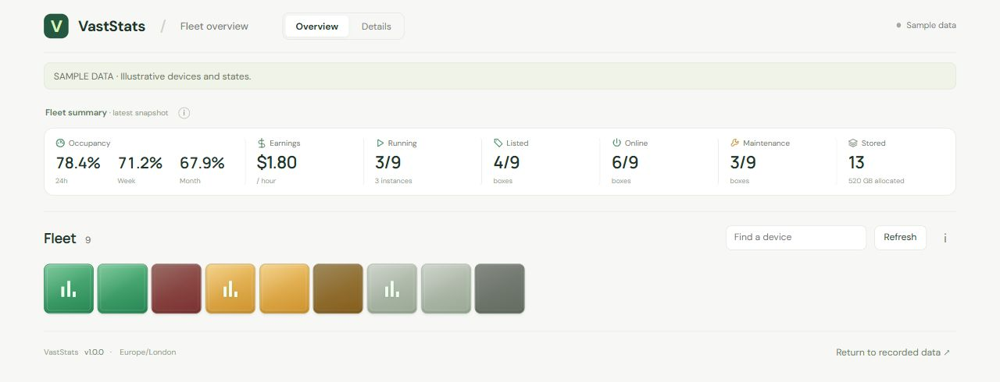
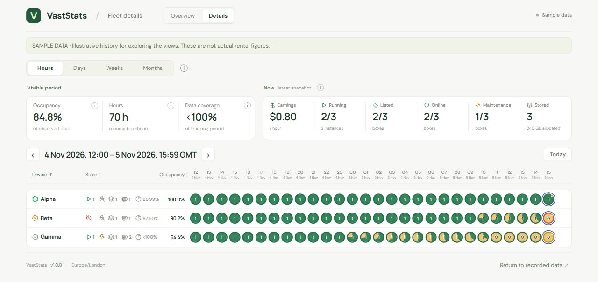

# VastStats

A self-hosted dashboard for Vast.ai hosts. See the current state of your fleet, explore historical utilisation, and track the current compute and storage earning rate.





*Screenshots use illustrative demo data.*

## Install

Supports **Debian 13, Ubuntu 24.04/26.04**, systemd, and **amd64/arm64**. Run these two lines on the server (omit `sudo` if already root):

```bash
sudo apt-get update && sudo apt-get install -y curl ca-certificates && curl -fsSL https://raw.githubusercontent.com/Grumpator/VastStats/apt/install.sh -o vaststats-install.sh
sudo sh ./vaststats-install.sh
```

The installer verifies and adds the signed VastStats APT source. If the configured sources cannot supply Node.js 24+, it also enables the signed NodeSource 24 repository; APT then installs the dependency. Use `sudo sh ./vaststats-install.sh --no-node-source` to require your own Node source instead.

Installation asks for your **restricted Vast API key** using a hidden-input prompt. Use the permissions in [vast-api-permissions.json](config/vast-api-permissions.json). The key stays on the server. Historical earnings additionally require the included `billing_read` permission; machine status and occupancy can work without that permission. The package creates a non-login Linux service account named `vaststats`, prepares its directories and starts the service.

Open **http://YOUR_SERVER_IP:3000/**. The first history import may take a little while; current status continues to refresh during it.

## Update

Publishing a stable GitHub Release builds and publishes the next package. On the server:

```bash
sudo apt-get update && sudo apt-get install --only-upgrade vaststats
```

`apt-get update` discovers versions; the install/upgrade step applies them. Normal `apt-get upgrade` also includes VastStats. Updates retain the API key, configuration, private identity and historical data.

To change the key, run `sudo dpkg-reconfigure vaststats`. To inspect the service, use `systemctl status vaststats` or `journalctl -u vaststats`.

## What the dashboard shows

**Overview** shows one adaptive square per device. Green means listed, amber maintenance and grey unlisted. Animated bars indicate running rentals. Offline devices flash red when listed, amber during maintenance and grey when unlisted. Unknown or overdue states are identified explicitly.

The summary shows **24h / Week / Month occupancy** matching the current Occupancy periods, current **hourly earnings**, and fleet-wide running, listed, online, maintenance and stored counts. Earnings use running GPU contract prices and allocated storage, including stopped instances; bandwidth is excluded. Tap a summary for its explanation or breakdown.

**Occupancy** shows one row per device. **24h** contains 24 hourly circles, including the current hour; **Week** contains the Monday–Sunday calendar week, including future days; **Month** shows the calendar month in daily circles; **Year** shows the calendar year in monthly circles. Arrows move by the selected period and cannot advance beyond the current period. Future time is excluded from statistics. On narrow screens the timeline scrolls horizontally with device columns fixed; statistics always cover the full selected period. Click a month or day to drill down. Select an occupancy reading on Overview to open the matching Occupancy period. Device, state and occupancy columns can be sorted.

Each circle represents one period: **green = observed running**, **amber = observed idle**, **grey = missing data**. Its number counts running episodes: stopping and restarting the same instance counts twice. An amber dot marks incomplete coverage. Occupancy percentages use observed time; missing telemetry is not treated as idle. Time before available history and future time are excluded from coverage.

Hover or tap a device for current state, verification, reliability, GPUs, instances, utilisation and freshness details. Historical borders use actual recorded status sightings, rather than inventing offline or maintenance intervals between checks.

**Earnings** shows recorded **Today / This week / This month / Total** amounts in USD, including GPU, bandwidth and storage. The week starts on Monday and the month on the first, both in UTC. Total covers the available daily report (up to 366 UTC dates). Reports may lag: an unreported day shows an amber waiting icon. No extra commission adjustment is applied.

The daily graph supports 7/30/90 days, this year and custom UTC date ranges. Group by source, machine or GPU model. The table shows each series' period total and average, and lets you choose which lines to plot. The hourly average skips missing days and uses the elapsed UTC hours for partial days. By GPU estimates earnings per GPU-hour for each model, weighting the reported hours by each machine's last known GPU count. It includes idle time and needs a known count for each reporting machine. Older hardware changes may not be reflected. Hover or tap a day for a breakdown ranked highest first.

Machine and GPU history share the same daily device cache. Vast's machine filter leaves daily rows fleet-wide, so the app requests one account-wide breakdown per day and reuses it across machines, GPU groups, ranges and restarts. Initial backfill runs in the background, with progress visible and requests paced at least 2.5 seconds apart. Plot up to eight machines or GPU groups plus the fleet total. Current-day matrices refresh on demand after 30 minutes, recent closed days after six hours, and older days after seven days. Failed days keep saved data and back off before retrying; missing reports remain gaps.

**Market** uses the existing read-only API key, keeps one snapshot in memory for 15 minutes, and starts refreshes when the view is open. Supply counts cover individual GPUs worldwide, while price samples count distinct hosts. Sparse same-model samples fall back to offers with similar reported GPU memory and DLPerf. The estimated host range uses market offers and [Vast’s typical renter markup](https://vast.ai/article/how-much-money-can-you-earn-renting-out-your-gpu-on-vast-ai). Your listings and booked contract prices are displayed separately. Market is enabled by default when a Vast API key is configured. Set `MARKET_ENABLED=0` to disable it.

Use **Add GPU** to watch up to eight models outside your fleet in the current browser. The picker combines the supply snapshot with Vast’s GPU catalogue, cached for 24 hours, so it includes laptop models even when Vast omits their supply figures. Opening the picker makes no extra calls. Each watched model gets a shared price sample of up to 60 available offers, refreshed at most once every 15 minutes in normal operation while the Market page is open. When fewer than three hosts offer the watched GPU and the sample provides its memory and DLPerf, two additional searches fetch up to 30 comparables on each side of its DLPerf score. The estimate can combine laptop and desktop matches with observed same-model asks. The card displays the direct prices separately.

**Devices** is a sortable fleet inventory with column filters for status, GPU model and count, occupancy, reliability, and stored images. The table icon switches between compact and detailed views and remembers the choice in your browser. Both views show GPU count and model together. Detailed adds worked time, images, average earnings and the full rate breakdowns. The period selector changes Occupancy. Worked totals confirmed running time over the reported UTC billing days, or all available telemetry when the billing report is unavailable. The recorded total comes from the available UTC billing report. The average divides that total by the fleet's reported clock hours, which can understate the rate for a device that joined partway through. Devices reuses the existing status, earnings and occupancy snapshots without additional Vast requests. Set `DEVICES_PRIVATE=0` to hide the extra earnings, contract and rate columns from Devices.

The dashboard serves these views to anyone who can reach it, including through a reverse proxy. On a public URL, the default views include fleet earnings, contract details and configured rates.

Settings is a placeholder. Planned settings are tracked in [TODO.md](TODO.md).

All pages share the same **Fleet: Overview / Devices / Occupancy / Earnings / Market / Settings** navigation. A shallow row below the header shows **running boxes**, **current earnings/hour** and **earned today** on every page. Historical metrics remain page-specific; Occupancy's period selector sits below its summary pills. Info controls open one consistent popover with a close button, Escape and outside-click dismissal; routine timestamps and explanations are kept inside it. Unreported earnings use an amber waiting icon that opens an explanation. Old `details.html` links redirect to `occupancy.html`, preserving query parameters.

## How it works

One Node.js process serves the dashboard and collects data independently of browser activity:

- **Every 5 minutes:** owner-scoped machine states and current contract rates.
- **Every 30 minutes:** detailed telemetry, with overlap and periodic reconciliation for late data; independently, one account-wide earnings report supplies Today/Week/Month/Total amounts. Earnings failures retain the last successful report and do not block occupancy/status updates.
- **On first setup:** automatic machine discovery using Vast hostnames, plus all historical telemetry still available from Vast.

History is cached on disk and published atomically. Failed requests retain previously collected data. Current status, detailed history and recorded earnings have separate freshness indicators; delays in Vast telemetry remain visible as missing coverage. Closing a browser does not stop collection; stopping the service does.

Hourly, daily and monthly display summaries are precomputed before each history import is published and saved alongside that history. Existing installations build this derived cache once on startup; it can be rebuilt from the original history. Occupancy loads only the summaries needed for its selected period. Recently visited periods stay in browser memory, so switching back needs no history request. A lightweight status check detects new history or recorded status evidence and refreshes affected cached views. Current status remains independent; elapsed-time coverage continues to update without inventing new observations.

## Configuration and data

| Location | Purpose |
| --- | --- |
| `/usr/lib/vaststats` | Package-managed application files |
| `/etc/vaststats/vaststats.env` | Protected API key and optional HOST, PORT, DATA_DIR settings |
| `/var/lib/vaststats/data` | Persistent identity, current snapshots, observations and history |

The app and data are separate. Package upgrades never replace the data directory. Back up the **entire data directory**, including `identity.json`, together; stop the service first for a consistent filesystem backup. Removing the package retains configuration and data. Purging removes configuration but still retains data and its owning service account. Data reset is a separate deliberate administrator operation, never an installation or upgrade side effect.

The dashboard and its read-only API listen on all IPv4 interfaces at port 3000 by default. Configure `HOST=127.0.0.1` and an HTTPS/authentication reverse proxy if desired, then restart the service. Public access to the dashboard also permits access to its sanitized API responses. API keys, raw contracts and private Vast machine IDs are never served.

A blank key permits an unconfigured installation; collection starts after configuration. Unattended installations can preseed `vaststats/api-key` through debconf. Existing configuration is preserved during upgrades; the temporary password answer is cleared after use.

## Run from source

With Node.js 24+ installed, copy `.env.example` to `.env`, set `VAST_API_KEY`, then run:

```bash
npm test
npm start
```

The source defaults to `0.0.0.0:3000` and `./var/data`. `.env` and runtime data are ignored by Git. `?demo=1` shows sample data without changing stored data. No external npm runtime dependencies or frontend build step are required.

## Build and release

`npm run build:deb` creates the architecture-independent Debian package in `dist/`. The package declares `nodejs (>= 24)` and standard Debian service/configuration dependencies. APT resolves these from configured sources.

**Only publishing a stable GitHub Release triggers package and APT publication. Creating or pushing a tag alone does not.** The release tag must match the app version, for example `v1.0.0` for `1.0.0`.

See [release maintenance](docs/releasing.md) for signing setup, validation and the publication workflow.
